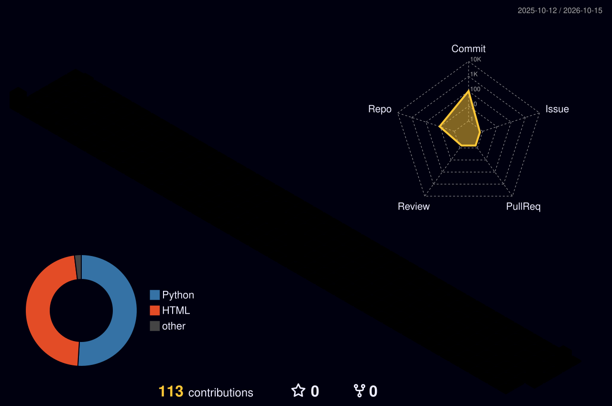

<p align="center">
  
</p>

<p align="center">
  
</p>

<p align="center">
  <a href="https://www.linkedin.com/in/sgrdas/"></a>
  <a href="mailto:ravidassg250@gmail.com"></a>
  
</p>

---

## 🖥️ ~/ravidas

```bash
ravidas@github:~$ whoami
S G Ravidas - Computer Science Engineer | AI/ML & Full-Stack Developer

ravidas@github:~$ cat about.txt
I build practical software with Python, Java, ML, web tech and databases.
Fresh CS graduate (KSSEM, Bengaluru) focused on real-world projects.

ravidas@github:~$ cat status.json
{
  "working_on": "LifeXAI - explainable AI for healthcare risk",
  "learning":   ["DSA", "Advanced Java", "Python", "SQL", "APIs", "Cybersecurity"],
  "open_to":    ["Software Developer", "Python Developer", "Java Developer", "AI/ML", "Full-Stack"],
  "location":   "Bengaluru, India",
  "status":     "available for entry-level roles"
}
```

---

## 🎓 Education

**B.Tech / B.E. in Computer Science & Engineering** - KSSEM College, Bengaluru - CGPA **8.23**

---

## 🛠️ Tech Stack

<p>
  
  
  
  
  
  
  
  
  
  
  
  
  
</p>

---

## 🤖 AI / Machine Learning

`Machine Learning` `Random Forest` `KNN` `Decision Trees` `K-Means` `PCA` `SHAP` `LIME` `Data Preprocessing` `Predictive Modeling`

---

## 🚀 Featured Projects

| 🧠 LifeXAI | 💼 AI Job Market Insights | 🌾 AI Fertilizer Optimizer |
|---|---|---|
| Explainable AI framework that analyzes lifestyle data, predicts health risk and explains each prediction. | Career intelligence platform that finds in-demand skills and roles and gives ML-driven career insights. | Helps farmers choose fertilizer from crop and soil data while minimizing cost. |
| `Python` `FastAPI` `React` `TypeScript` `SHAP` `LIME` | `Python` `Flask` `SQLite` `SQLAlchemy` `Chart.js` | `Python` `ML` `Flask` `SQLite` |
| *Explainable AI, Healthcare Analytics* | *Job Analytics, Resume Analysis* | *Smart Agriculture, Cost Optimization* |

---

## 🧪 Testing & Automation

`Selenium WebDriver` `TestNG` `Maven` `Automated UI Testing` `Test Case Design` `Browser Automation`

---

## 📚 Currently Improving

```text
Java ........... OOP | Collections | Exception Handling | DSA
Python ......... APIs | Flask / FastAPI | Machine Learning
SQL ............ Queries | Joins | Subqueries | Database Design
Dev Practices .. Git & GitHub | REST APIs | Testing | Deployment
```

---

## 📊 GitHub Stats

<p align="center">
  
  
</p>

<p align="center">
  
</p>

<p align="center">
  
</p>

---

## 🌌 My Contribution Skyline

<p align="center">
  
</p>

---

## 📫 Reach Me

📧 [ravidassg250@gmail.com](mailto:ravidassg250@gmail.com) | 💼 [LinkedIn](https://www.linkedin.com/in/sgrdas/)

<p align="center">
  <b>Building projects. Learning every day. Growing into a better software developer. 🚀</b>
</p>

<p align="center">
  
</p>
